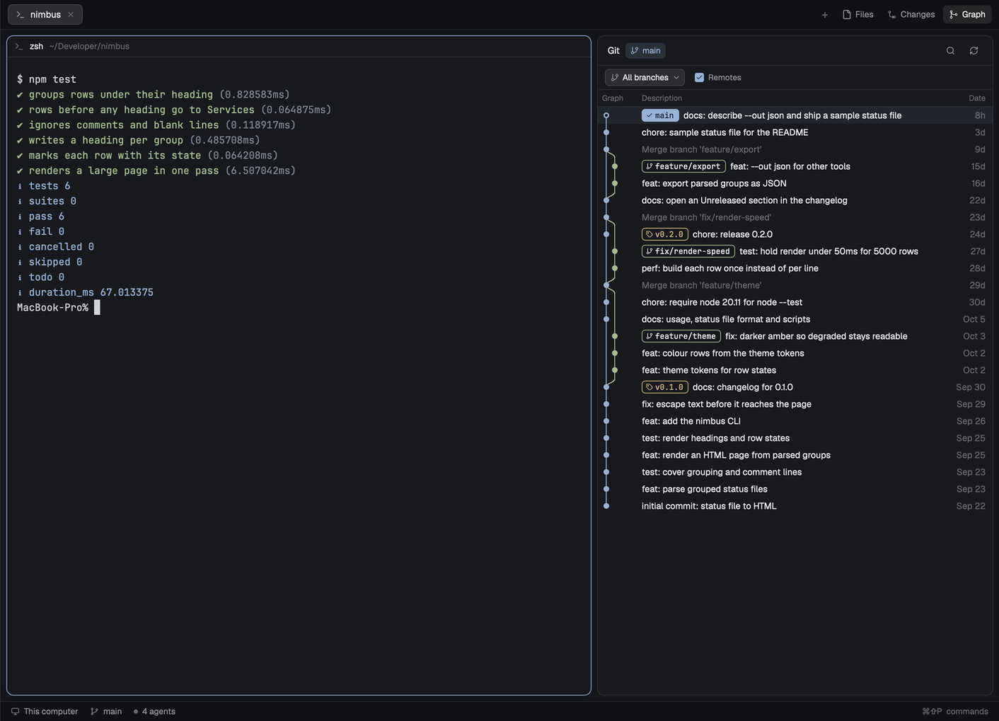
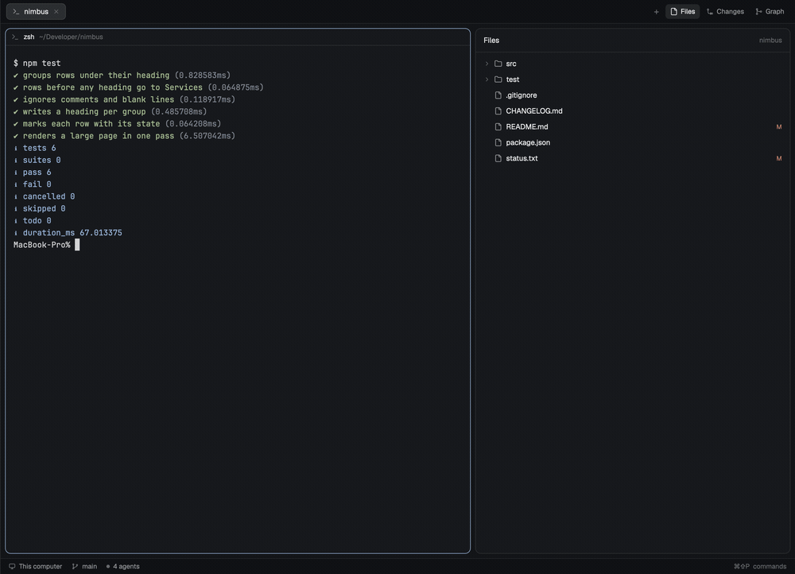

# Real Engineer

A layout for the [Herdr](https://herdr.dev) desktop app. It is Herdr's `main`
layout with a few changes. The top bar drops Herdr's **Changes** button and
keeps **Files** and **Git**. The Files panel gets a right-click menu, file
operations, and an editable preview. The side panel's **Git** view holds a
commit graph of the focused terminal's repository, with a branch filter and a
find bar. And an **Awake** switch above the footer keeps the Mac up, on demand
or while agents work. A Markdown window (`cmd-shift-m`) and Review
(`cmd-shift-r`) come along too. Review and Git identity are two more tabs in
the Git view.



The mods live in `mods/`. Two of them start from shipped Herdr mods and stay
small by keeping local changes as a patch over the shipped file. See
[MAINTAINING.md](MAINTAINING.md).

## What's in it

| Path | What it is |
|------|------------|
| `layouts/real-engineer.json` | Herdr's `main` layout. The top bar uses `re-tabs`, the Files panel uses `re-files`, and the side panel stack `panel-body` has a third child, `graph`, showing `re-git-graph`. |
| `mods/re-tabs/` | The tab bar, with Files and Git panel keys. |
| `mods/re-files/` | The Files panel, with a right-click menu and an editable preview. |
| `mods/re-git-graph/` | The commit graph, with a branch filter, a find bar, the Pull request tab, local changes in its uncommitted row, and a Config tab that sets the repository's `user.name` and `user.email`. |
| `mods/re-awake/` | On, Agent, Off: keeps this Mac awake with `caffeinate`, on demand or while an agent on it works. macOS only. |
| `mods/re-markdown/` | A read-only Markdown window for the focused pane's folder. `cmd-shift-m`. |
| `docs/git-config.md` | What the Config tab sets and how Git resolves an identity. |
| `keys.json` | The keys the layout expects. Merge it into yours. |
| `install.sh` | Copies the mods and the layout into `~/.config/herdr-app`. |
| `RECIPE.md` | The brief to build the layout from scratch. |
| `MAINTAINING.md` | How to merge a Herdr update into the mods. |
| `tools/sync.mjs`, `sync/` | The patches and the tool that applies them. |

## What each mod adds

### re-tabs: a Git button and panel keys

- A **Git** button after Files. It shows only in a layout that has
  a `graph` node.
- Each panel button opens its panel, switches the open panel to it, or closes
  the panel when it already shows.
- Key commands `re-tabs.files` and `re-tabs.graph` do what the buttons do.
  `keys.json` binds them to `cmd-shift-e` and `cmd-shift-g`.



Everything else is Herdr's tab bar as of 0.1.14.

### re-files: a file manager in the Files panel

- **Right-click** a file, a folder, or the empty part of the tree:
  - Copy Path, Copy Relative Path, Copy Name.
  - Reveal in Finder (`open -R`) and Open in editor. These two show only for
    spaces on this computer.
  - Open in Terminal: a new tab in that folder, or in a file's folder.
  - New File, New Folder, Rename, Duplicate (`a copy.txt`, then
    `a copy 2.txt`).
  - Delete, which moves the item to the Trash with `/usr/bin/trash` after a
    dialog asks first.
  - On the empty part of the tree only: **Set editor command**. Open in VS
    Code runs this program with the path as its one argument. The default is
    `code`. If that program can't start, it falls back to
    `open -a "Visual Studio Code"`.
- **Editable preview.** Click a file on this computer and you can edit it.
  `cmd-s` saves. A `●` in the header marks unsaved edits. The back arrow asks
  to save or discard them. Files in spaces on another machine stay read-only.
- **The tree keeps its place.** Opening a file and going back returns the tree
  to the same scroll offset.
- **Ignored entries fade.** A file or folder matched by `.gitignore` — and
  everything inside an ignored folder — is drawn at 55% opacity, dim and
  italic, with an `Ignored by Git` tooltip. One
  `git ls-files --others --ignored --exclude-standard --directory` per refresh
  answers for the whole tree.
- **Conflict bar.** If the file changed or was deleted on disk while you
  edited it, a save shows "File changed on disk" or "File deleted on disk"
  with **Reload** and **Overwrite**.

### re-git-graph: the commit graph

A commit graph drawn as a native Herdr mod: no web view, no embedded browser.
It has a branch filter, a find bar, a Pull request tab and a Config tab.

- **The graph.** The table (graph, description, date, and when there's
  room, author and commit), newest first, with a lane per branch and curves where
  branches fork and merge. Merge commits are muted.
- **Branch filter.** A dropdown in the toolbar: All branches, Current, or any
  set of local and remote branches, with a box to filter the list. The choice
  is kept per repository and survives restarts.
- **Find.** `cmd-f` or the search button opens a find bar. It highlights the
  commits whose subject, author, branch or tag name, or hash prefix (4 or more
  hex characters) match. Rows are never hidden. Enter and shift-Enter step
  through the matches. Stepping past the last loaded match loads more history,
  up to 2000 commits.
- **Many repositories.** Focus a terminal in a folder that holds
  repositories, and the panel lists them, grouped by folder. Each row shows its branch,
  uncommitted changes, and whether it's ahead (↑) or behind (↓) its upstream,
  not pushed, or has no remote. Click one for its graph. Its name in the header
  drops the list down to switch to another, and **‹ Git** goes back.
  Right-click one for a new agent or terminal tab in it, then pull, push or
  fetch, commit, stash or reset its changes, open its remote's page, or copy
  its path. It searches 3 folders deep (1 to 5 in the gear's settings), and
  skips hidden and `node_modules`-style folders. It never searches your home
  folder or anything above it.
- **Where you are.** The checked-out branch's label is filled with a ✓, the
  header shows the branch, and HEAD is a ring on a tinted row.
- **Labels.** Local branches carry their remote (`main | origin`). Remote-only
  branches and tags have their own. A toolbar checkbox shows or hides remote
  branches. A label too long for its chip is cut with `…`; hover it for the
  full name.
- **Uncommitted changes** sit on top as their own row, joined to HEAD by a
  dashed line. Selecting the row lists the changed files; a file opens its
  diff, and its **Stage** or **Unstage** button moves it in or out of the
  index. `cmd-shift-r` lands there.
- **Actions above the graph.** While the worktree has changes, a row shows
  **Stage all**, **Commit** and **Stash**. When the branch is behind its
  upstream it adds **Pull**, and when ahead it adds **Push**. The buttons open
  the same dialogs as the menus.
- **Git config.** The **Config** tab is who this repository commits as. It
  shows `user.name` and `user.email` with the scope each comes from, and the
  pairs you have used before: pick one to write it to the repository's own
  config, or type a new pair. Every write asks first, in a confirm over the
  window, and a repository with no identity of its own is asked once when the
  panel shows it. The list keeps 12 and lives in `shared.json`, and
  the tab only shows when the folder is one repository. See
  [docs/git-config.md](docs/git-config.md).
- **Double-click a branch label** to check it out. Double-click the remote part
  of the current branch's label to pull its upstream, after a confirm. Another
  remote branch still checks out, and one with no local branch asks for the
  local name first.
- **Right-click** what's under the pointer:
  - a branch: checkout, rename, delete, merge into the current branch, rebase
    onto it, push, copy name
  - a remote branch: checkout, merge, delete it on the remote, copy name
  - a tag: delete, push, copy name
  - a commit: add tag, create branch, checkout, cherry pick, revert, merge,
    rebase, reset (soft, mixed, hard), copy hash or subject
  - uncommitted changes: commit, stash, reset, and on each file row **Discard**
    (behind a confirm that names what is lost) and **Open file** (Herdr's Files
    panel, on that file)
- **Commit details.** Click a commit for its message, hash, parents, author,
  date and changed files. Click a file for its diff in the pane, and **⤢** in
  the diff header opens it in a window sized for two columns: side by side at
  900 px or wider, inline below, `s` to cycle the three layouts, and `alt+z` to
  wrap long lines instead of cutting them at the edge.
- **Live.** It reloads when refs move, refreshes the uncommitted row as you
  edit, and fetches with one button. It loads 300 commits at first, and 300
  more each time you scroll to the end.

Everything that changes the repository asks first in a dialog, except checking
out a local branch and the Fetch button. When git refuses, its own message
stays in the dialog.

### re-awake: keep the Mac awake

A row above the footer: a coffee icon, the word **Awake**, and three pills.
**On** holds the Mac awake until you turn it off. **Agent** holds it only while
an agent on this computer is working, and lets go when they all finish. **Off**
lets macOS sleep as usual.
`cmd-shift-a` cycles them, and the choice is remembered.

The icon turns `accent` while the assertion is up. When it can't start, it
turns red and carries the reason. Closing the lid still sleeps the Mac; no
user process can hold it awake through the lid.

### re-markdown: a Markdown window

`cmd-shift-m` opens a 900 px window over the layout. It lists the Markdown
files in the focused pane's folder: `git ls-files` first, or a depth-3 search
outside a repository, sorted shallowest first and capped at 40. Click one to
render it. `−` and `+` in the header change the width in 120 px steps between
560 and 1600, and the choice is kept.

The window is read-only. `TextView` draws headings, lists, tables, code blocks
and links; links open in the browser, and YAML front matter shows as a YAML
block instead of a horizontal rule. The file reloads while it is open. Esc or
the `×` closes it, and `←` returns to the list. Another mod can hand it a file
with `props: { path }`.

When the file open in the Files panel is Markdown, its header shows
**Preview**, which opens the window on that file. Opening it again replaces the
window in place instead of stacking a second one.

### Review: local changes and Pull request

The Git panel has three tabs: **Git**, **Pull request** and **Config**. Local
changes are the graph's own top row, **Uncommitted changes**: selecting it
lists the changed files with their added and deleted lines, and a file opens
its diff. `cmd-shift-r` shows the panel on that row. A layout without a `graph`
panel still gets the old standalone review pane, opened with
`props.view: "review"`, which keeps its Changes tab (worktree, or the branch
against its base) and reviewed marks.

**Pull request** runs `gh pr view` and `gh pr diff` for the current branch.
When the branch has no pull request it lists the open ones. The tab shows the
PR's state, base and head, body, existing comments and reviews, and the same
diff view.

`j` and `k` move between files, `r` marks a file reviewed, `s` switches
unified and split, and Esc goes back to the file list. Reviewed marks are
local to the panel.

Comment, Approve, Request changes and Merge sit in the Pull request header.
Each opens a card over the pane, names the pull request, and asks again before
running `gh pr review` or `gh pr merge`. Merge chooses Merge, Squash or Rebase
and can delete the branch afterwards. When `gh` fails, its own message stays in
the card so you can retry.

## What it runs

Read this before you install. The mods run programs and one of them reaches
the network.

- **re-git-graph** runs `git` in the focused repository (on its machine, for
  spaces on another machine) and reads files there to show an untracked file's
  contents. In a folder that isn't a repository, one `find` looks for
  repositories, and each one found gets a `git status` (every 15 seconds while
  the list shows). Git reaches the network only when you press Fetch, Fetch
  all, Pull, Push, or delete a remote branch. Every git call is an argument
  list, never a shell, and names you type can't start with `-`.
- **re-git-graph** also makes one request of its own: at most once a day it
  asks GitHub's public API for this repository's latest release
  (`api.github.com/repos/ngothanhluc/herdr-real-engineer/releases/latest`),
  with no token and nothing about you or your repositories. To stop it, click
  **Stop checking** in the update window, or set `CHECK = false` in
  `mods/re-git-graph/update.js`.
- **re-files** runs `sh` to list folders (as Herdr's `files` does), `open -R`
  for Reveal in Finder, your editor command (`code` by default, else
  `open -a "Visual Studio Code"`), `/usr/bin/trash` for Delete, and `test`,
  `touch`, `mkdir`, `mv -n` and `cp -Rn` for the other file operations. It
  writes files only when you save the preview.
- **re-awake** asks `launchctl` to run `/usr/bin/caffeinate -i -s -w <Herdr's
  pid>` while it's on or while a local agent works, and `launchctl remove` to
  stop. It reads the process list once to find Herdr's pid. Nothing leaves the
  machine.
- **re-tabs** runs no programs.
- **re-git-graph**'s review view runs `git` for its Changes tab and the Config
  tab, the same read-only calls as the graph, and `gh` for the Pull request tab: `gh pr view`,
  `gh pr diff`, `gh pr list`, `gh pr review` and `gh pr merge`. It uses the
  account you signed in with `gh auth login`. Nothing is fetched from git for
  you; the pull request is shown as GitHub has it.
- **re-markdown** runs `git ls-files` (or one `find`) and reads the file you
  pick. It writes nothing.

## Install

Ask your Herdr agent to add the layout from herdr.dev/layouts, or:
*"add the layout at github.com/ngothanhluc/herdr-real-engineer"*. It reads
[RECIPE.md](RECIPE.md) and the files, copies the mods and the layout, and
merges `keys.json`.

Or by hand:

```sh
git clone https://github.com/ngothanhluc/herdr-real-engineer
cd herdr-real-engineer
./install.sh
```

`install.sh` copies the mods and the layout into `~/.config/herdr-app`
(or `$HERDR_APP_HOME`). It copies, not links, because Herdr doesn't load a
mod's SVG files through a symlink.

Then merge `keys.json` into `~/.config/herdr-app/keys.json`: add its three
sections, and keep any key you already use. Then switch to the layout:

```sh
herdr-app do layout.switch '{"name":"real-engineer"}'
```

`ctrl-shift-l` (`cmd-shift-l` on macOS) switches back to your own layout.
Deleting `layouts/real-engineer.json`, the three `mods/re-*` folders and the
keys sections removes it.

The graph also opens as a pane, beside a terminal:

```sh
herdr-app do pane.split '{"direction":"right","mod":"re-git-graph","props":{"folder":"/path/to/repo"}}'
```

### Keys

| Key | Where | Does |
|-----|-------|------|
| `cmd-shift-e` | this layout | Toggle the Files panel |
| `cmd-shift-g` | this layout | Toggle the Git panel |
| `cmd-s` | Files panel | Save the edited file |
| `cmd-shift-a` | this layout | Cycle Awake: On, Agent, Off |
| `cmd-shift-m` | this layout | Open the Markdown window |
| `cmd-shift-r` | this layout | Show the Git panel on uncommitted changes |
| `cmd-f` | Graph | Open the find bar |

Editing `keys.json` makes the whole file yours. Herdr then stops updating it,
so new default shortcuts in later Herdr releases must be added by hand.

## Limits

- Tested on Herdr app 0.1.14 on macOS. Linux and Windows aren't tested.
- `re-tabs` and `re-files` start from shipped Herdr mods. After a Herdr update,
  run `node tools/sync.mjs --check`; see [MAINTAINING.md](MAINTAINING.md).
- The preview edits only files on this computer, up to 1 MiB.
- Delete needs `/usr/bin/trash`, which recent macOS has. In a space on another
  machine it fails unless that machine has it too.
- Find matches a commit's subject line, author, branch and tag names, and hash
  prefix. It doesn't search message bodies or changed files.
- The repository list needs `find` and `env`, so it works on macOS and Linux, not Windows.
- Herdr stops a command after 30 seconds, so a fetch, pull or push over a slow
  network, or a slow pre-commit hook, can fail there.
- A very large history loads slower the first time if the repository has no
  commit-graph file. `git commit-graph write --reachable` (or
  `git maintenance start`) in that repository fixes it.
- Not in this version: pull in the graph (a repository row's menu has it),
  interactive rebase, and per-file actions in commit details.
- The review view's Pull request tab needs `gh`, signed in. Without it the tab
  says so and the Git tab's uncommitted row still works.
- A `gh pr diff` larger than Herdr's 30 s or 8 MiB command budget shows the
  error instead of the diff. Review comments are summary bodies only; there are
  no inline line comments.
- `re-markdown` lists git-tracked Markdown files inside a repository. A new file
  shows after `git add`, or outside a repository. It renders up to 1 MiB, the
  read limit for a mod.

## Development

```sh
npm test                                     # every tests/*.test.mjs, also run in CI
node tools/sync.mjs --check                  # re-tabs and re-files match their patches
./install.sh                                 # copy the mods and layout into Herdr
herdr-app check ~/.config/herdr-app/mods/re-git-graph   # and re-files, re-tabs
```

The tests build throwaway repositories (with a bare "remote") and folders, and
check the graph's parsing, lanes, labels, menus, validation and every action
against real git, the branch filter and find matching, `re-files`' menus and
file operations, and the review view's diff parsing and `gh` argv.

When behavior changes, update `RECIPE.md` so the recipe still builds what the
layout does.

## License

The work written here is MIT, see [LICENSE](LICENSE). Code that came from
Herdr's shipped mods and layout keeps Apache-2.0
([LICENSE-APACHE-2.0.txt](LICENSE-APACHE-2.0.txt)). The notice for the code in
`mods/re-git-graph/` is in [mods/re-git-graph/LICENSE](mods/re-git-graph/LICENSE).
Icon notices are in each `icons/LICENSE-*.txt`.
