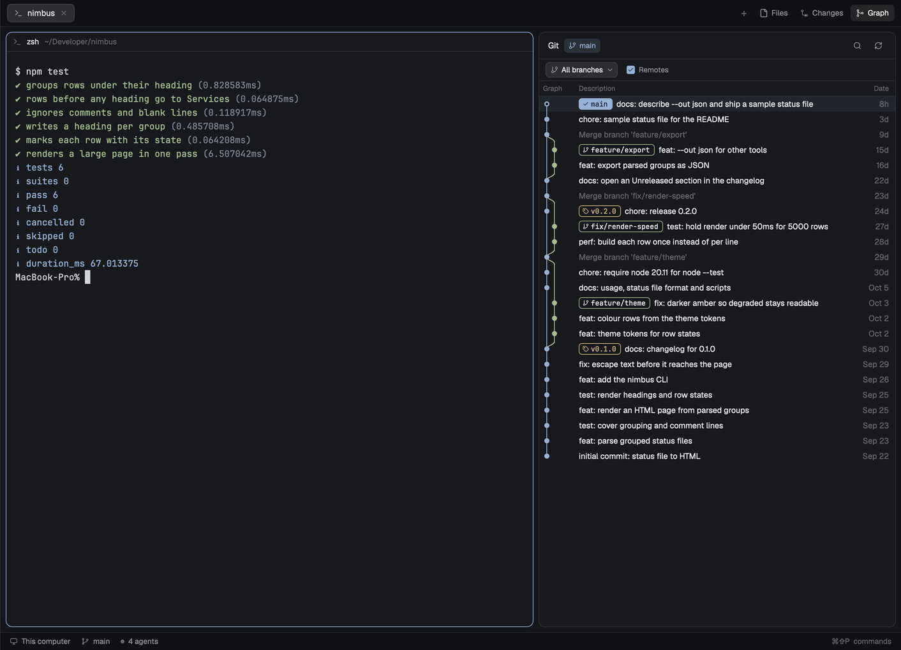

# Real Engineer

Herdr's main window with a git view and a working file browser. Spaces and
agents on the left, terminals in the middle, and a side panel on the right that
the top bar's **Files**, **Changes** and **Graph** buttons open. Files is a tree
with a right-click menu (copy paths, reveal, open in an editor or a terminal,
new, rename, duplicate, move to Trash) and a preview you can edit and save with
`cmd-s`. Graph is a commit graph of the focused terminal's repository, after VS
Code's Git Graph: colored lanes for every branch, labels for branches, remotes
and tags, uncommitted changes as a dashed row on top, Git Graph's right-click
menus, a branch filter dropdown and a `cmd-f` find bar.

## What you see

The window is Herdr's `main` layout, unchanged except for the top bar, the
Files panel and the Graph panel. Left to right, on `canvas`, 1px `border`
dividers:

- **Sidebar**, 268px (44 to 480), `chrome`: Herdr's brand row (46px), the
  Spaces and Agents lists sharing the height, a 30px **Awake** row of ours
  (see below), and the footer (69px). Herdr's own mods, untouched.
- **Work column**, top to bottom:
  - **Top bar**, 42px, `chrome`, bottom border, draggable window area. Herdr's
    tab bar (tabs, the `+` button) and on the right the panel buttons:
    **Files**, **Changes**, **Graph**. Each is 26px tall, 8px side padding,
    radius 6, a 14px icon and a 12px label, `muted` on `chrome`, and
    `foreground` on `selected` while its panel shows. Graph's icon is
    `mods/re-git-graph/icons/graph.svg`.
  - **Body**, a row with 8px padding and 8px gap: the panes (radius 10, 1px
    `border`, 1px `accent` focus, a 30px pane header), and the **side panel**,
    368px (280 to 900), hidden at start. It is a stack of three: Files,
    Changes (Herdr's), Graph.
  - **Status bar**, 28px, Herdr's.

### Files panel

Herdr's Files panel: a 42px header with "Files" semibold and the root folder's
name (or the open file's path) in `dim` on the right, then the tree (chevrons,
folder and file icons, at most 500 entries per folder and 5,000 in all). Added:

- A `●` in `foreground` at the right of the header while the open file has
  unsaved edits.
- A **conflict bar** under the header, 36px on `raised`, bottom border: "File
  changed on disk" or "File deleted on disk" in `blocked`, then **Reload** and
  **Overwrite** buttons (24px, radius 6, 1px `input` border).
- The preview of a file on this computer is an editable editor, never
  truncated. A file on another machine stays read-only, cut at 400,000
  characters as Herdr's is.
- **The menu**: a 240px popup at the pointer on `popover`, 5px padding, 30px
  rows (radius 7, a 14px `muted` icon, 12.8px text), 1px `border` separators.
  Delete is `ansi1`. Rows, by what was right-clicked:
  - a file or folder: Copy Path, Copy Relative Path, Copy Name, Reveal in
    Finder, Open in VS Code, Open in Terminal; New File…, New Folder…,
    Rename…, Duplicate; Delete.
  - the tree's empty area (the root): Copy Path, Copy Name, Reveal in Finder,
    Open in VS Code, Open in Terminal; New File…, New Folder…; Set editor
    command….
  - In a space on another machine, Reveal in Finder, Open in VS Code and Set
    editor command… are left out.
- **Dialogs**, 420px on `popover`, 18px padding: a 15px semibold title with
  `Esc` on the right, a `muted` sentence, a 36px input (radius 9, `accent`
  border), an `ansi1` error line, and Cancel / the action on the right. The
  action is `solid`, or `ansi1` for Move to Trash. Titles: New File, New
  Folder, Rename file/folder, Move file/folder to Trash, Editor command, and
  Unsaved changes (Cancel, Discard, Save).

### Graph panel

One column on `background`, radius 10, 1px `border`, base type 12.5px. Top to
bottom:

- **Header**, 42px, 14px side padding, bottom border. The tool's name at 13px
  semibold: "Git" for a repository, "Manygit" for a folder of them (see
  **Manygit** below). A repository opened from the Manygit list shows a back
  chevron and "Manygit" (back to the list), then the repository's name as a
  chip (folder icon, `raised`, `selected` while open) that drops the list's
  rows down under the header, over the graph: `raised`, at most 260px with
  scrolling, the open repository `selected` with its name in `accent`, every
  row read again on opening. Picking one opens it; `Esc` closes the dropdown.
  Beside it, the current branch appears as a chip: 22px tall, radius 6,
  `accent` at 15% (`accent` + `26`) behind `accent` text, a 12px branch icon
  and the name at 11.5px semibold; detached HEAD reads `detached at <8 chars>`
  with a commit icon. On the right, 24px icon buttons in `muted`: Find (a
  magnifier, `selected` while the find bar is open; only when the history
  shows), Fetch (arrow down, only when the repo has remotes; it says
  `Fetching…` while running) and Refresh, and Settings (a gear) on the Manygit
  list and when a folder holds none. When a newer release is out, an `accent`
  dot and **Update Graph** sit before them. No commit count, as in Git Graph.
- **Manygit**, when the folder isn't a repository but holds some, after
  [manygit](https://github.com/rabeeh-ta/manygit)'s repository pane, in place of
  the toolbar and table. The header reads `Manygit`, `N repos` in `dim`. Rows
  grouped by the folder they're in (a 26px `dim` 11px heading, `group/`, `./`
  for the top; no headings when every repo is at the top), each 34px, indented
  28px under a heading (14px otherwise): the name at 11.5px (`accent` for the
  open one), right after it the uncommitted count as a 6px dot and number in
  `blocked` and how it stands against its upstream, and on the right the
  branch in `muted` with a 12px branch icon (`detached`; git's error in
  `ansi1` when status fails), at most 200px. Against its upstream, at 11.5px as
  Herdr's Spaces list draws it: `↑N` in `ansi2`, `↓N` in `ansi1` (both when it
  has diverged), nothing when it's in sync; then `not pushed` in `ansi1` (a
  remote, but the branch has no upstream; nothing on a detached HEAD),
  `no remote` `dim`, `upstream gone` `ansi1`, `…` while loading. A click opens
  the repository's graph with everything above; "‹ Manygit" or `Esc` (with
  nothing else open) returns to the list.
  **Right-click a row**: its remotes (`git config --get-regexp
  '^remote\..*\.url$'`) and the machine's agents (`knownAgents`, kept per
  machine and asked again after) are read, then a 268px menu opens at the
  pointer. First Herdr's own: `New <agent> tab` for up to 3 installed agents,
  most picked first as Herdr's + menu, and `New terminal tab`, each `tab.new`
  with the repository as its folder. Then what the row's token asks for first:
  behind, Pull, Fetch, Push; ahead, Push, Fetch, Pull; no upstream,
  `Push and set upstream…`, Fetch; otherwise Fetch, Pull, Push (all need a
  remote; Pull an upstream). Pull asks first and runs
  `git pull --ff-only --quiet`; Push is the graph's dialog (remote, set
  upstream); Fetch runs at once. With uncommitted changes: Commit, Stash, Reset
  uncommitted changes, the graph's dialogs. Last: `Open on <host>` (origin's
  web page), Copy path, Copy branch name. A row still loading, or that git
  can't read, has no menu.
  Fetch all (the fetch arrow and `Fetch all`, `Fetching 3/12…` while it runs)
  fetches every repository with a remote, 8 at a time:
  `env GCM_INTERACTIVE=0 GIT_TERMINAL_PROMPT=0 GIT_ASKPASS= git fetch --quiet`,
  so saved credentials and SSH's configuration work but nothing stops to ask
  for a login. A failure shows git's last line in `ansi1` where the branch goes
  and `fetch failed` as its token. It ends with a toast
  (`Fetched 12 repositories`, or `Fetched 10 of 12 repositories`, a warning).
  Settings opens a 240px popup with two 30px rows: `Scan depth` and a 56px
  input (1 to 5, 3 by default; `shared("re-git-graph.depth")`), and
  `Show tags` with a checkbox, off by default (`shared("re-git-graph.tags")`).
  A valid depth applies as it's typed; anything else turns the box `ansi1`.
  With tags on, each row shows its newest tag just before the branch: a tag
  icon and the name in `dim`, at most 120px.
- **Toolbar**, 34px, 10px side padding, bottom border:
  - the **branch filter** button: 24px, at most 220px, radius 6, `raised` with
    a 1px `border`, 11.5px, a 12px `muted` branch icon, the filter's name
    (`All branches`, `Current`, one branch's short name, or `N branches`),
    and a chevron down.
  - a `Remotes` checkbox (13px box, `accent` filled with a check when on).
- **Branch filter popup**, 260px at the pointer on `popover`, 6px padding:
  a 30px `Filter branches` input, then 28px rows (at most 10 shown, then it
  scrolls): `All branches` and `Current` (medium weight; hidden while the
  input has text), then every local branch (branch icon) and, with Remotes on,
  every remote branch except `*/HEAD` (cloud icon), short names. Each row has a
  13px checkbox (`accent` with a check when chosen). The highlighted row is
  `selected`. `No branches match` in `dim` when the filter hides them all.
- **Find bar**, under the toolbar while open, 34px, 10px side padding, bottom
  border: a 13px `muted` magnifier, a 24px `Find commits` input (radius 6,
  1px `input` border), the status at 11.5px `dim` (`3/12`, `No results` in
  `ansi1`, `Searching…`, and `· searched 2000 commits` when it stopped there),
  then 22px buttons: previous (chevron up), next (chevron down), close (×).
- **Column headers**, 24px, 11px `dim`: Graph (as wide as the graph),
  Description (the rest), Date (62px, right-aligned), and from a width of 600px
  also Author (120px) and Commit (66px). Each column but Description has a drag
  handle in the gap at one edge (8px wide, column-resize cursor, `border` on
  hover, a 1px `accent` line while dragging): Graph's on its right, the others'
  on their left.
- **Rows**, 24px each, a virtual list with a scrollbar:
  - The graph cell: lanes 12px apart from a 6px inset, at most 40% of the
    width. Lines are 1.5px strokes in lane colors `ansi4, ansi2, ansi5, ansi3,
    ansi6, ansi1, ansi12, ansi10, ansi13, ansi11, ansi14, ansi9` (cycling by
    lane); a change of lane is a cubic curve with vertical tangents inside half
    a row. Commit dots are 8px, filled with the lane color; HEAD's is a ring
    (2px lane-color border on `background`).
  - Labels, 6px apart, 18px tall, radius 5, 1px border, monospace 11px with a
    10px icon: a local branch (branch icon) bordered in its lane color, with a
    same-named remote riding on it as a second part (`main | origin`, the part
    tinted with the lane color at 12%); a remote-only branch (cloud icon); a
    tag (tag icon) in `ansi3`; a detached `HEAD` filled `accent`. The
    checked-out branch is filled with its lane color, text in `background`,
    semibold, with a check icon instead of the branch icon, and comes first.
    Names longer than 22 characters are cut with `…`. Labels and description
    clip together so the date columns never move.
  - The description in `foreground`; merge commits `dim`; HEAD's semibold.
  - Date as `now`, `12m`, `3h`, `6d`, `Oct 3`, `Mar 2025`, in `dim`. Author in
    `muted`; the hash's first 8 characters in monospace 11px `dim`.
  - HEAD's row tinted with its lane color at 8%; the selected row `selected`;
    a find match `accent` at 12% (`1f`), the current match `accent` at 35%
    (`59`); `hover` under the pointer.
  - **Uncommitted changes (N)** as the first row whenever the working tree has
    changes and HEAD is in the graph: a gray ring, a dashed gray line (3 on, 3
    off) down to HEAD's lane, `muted` text, `*` in the other columns.
  - With more history, a last row `Load 300 more commits` in `accent`.
    Scrolling it into view loads the next 300 (`Loading more commits…`
    meanwhile); a click does the same.
- **Details**, 320px under the list when a commit is selected, top border. A
  32px bar with `Commit <8 chars>` (or `Uncommitted changes` and an
  `Open Changes` link) and a `×`. Below, scrolling: the subject semibold, then
  label/value rows at 11.5px (64px `dim` labels): Commit (full hash,
  monospace, `accent`), Parents, Author `name <email>`, Date
  (`2026-10-28 12:09 · 2d`). These show the moment the commit is clicked, with
  `Loading files…` under them; then Committer when different, the body's lines
  in `muted`, `N files +a −d` and one 24px row per file: the status letter (A
  `ansi2`, D/U `ansi1`, else `blocked`), the folder `dim`, the name, `+a`
  `ansi2`, `−d` `ansi1`. Clicking a file turns the area into its diff: a
  `← Files` back link and the path, then 20px monospace rows, hunk headers on
  `raised`, added lines on `ansi2` at 9%, removed on `ansi1` at 9%, line
  numbers in a 34px `dim` column.
- **In place of the table**: centered, a 46px `raised` tile with a 22px icon,
  a 14px semibold title and a 12px `muted` line: `No folder`,
  `Not a git repository` (with the folder, `~`-shortened, and the search depth),
  `No commits yet`, `Can't read the history` (git's error, icon in `ansi1`),
  `Loading history…`.
- **The graph's menu** is a 268px popup at the pointer on `popover`, 5px
  padding, 30px rows (radius 7, a 14px `muted` icon, 12.8px text), 1px
  `border` separators; delete items are `ansi1`. **Its dialogs** are 420px
  wide, styled as the Files dialogs, with radio rows for a mode (38px, radius
  8, `accent` or, for a destructive mode, `ansi1`) and checkboxes.

### Awake row

30px above the footer, `chrome`: a 13px coffee icon
(`mods/re-awake/icons/coffee.svg`), **Awake** at 11.5px (`foreground` while the
assertion is up, `muted` otherwise), and on the right three 17px pills,
`On`, `Agent`, `Off` (10px, radius 4; the current one on `selected` with
`foreground`, the others `muted` on `chrome`). The icon is `accent` while the
assertion is up, `dim` when not, `blocked` with the reason in place of the
label when it can't start. On a system that isn't macOS the row reads
"macOS only".

## How it behaves

- **Agent statuses** (working, blocked, done, idle) are Herdr's own, in the
  sidebar's Agents list and the pane headers. This layout doesn't change them.
  Nothing in the three mods animates.

### Awake row

- **On** holds the Mac awake until it's turned off. **Agent** holds it while at
  least one agent in a space on this computer reports `working`, and lets go
  when none does. **Off** runs nothing.
- Clicking a pill sets that mode; `cmd-shift-a` (`re-awake.cycle`) goes
  `On` → `Agent` → `Off` → `On`. The mode is kept in `shared("re-awake")` and
  survives restarts.
- The poll is every 20 seconds; the row also re-checks when agent statuses
  change. What it shows comes from `launchctl list herdr-awake`, never from
  what it asked for, so a refused start shows red instead of a false On.

### Top bar

- **Graph** shows when the layout has a node with id `graph`. Files and Changes
  show as Herdr's do (`shared("workspace.panels")`, both by default).
- Clicking a panel button: if the panel shows that view, hide the panel;
  otherwise select it in `panel-body` and show the panel.
- Key commands `re-tabs.files` and `re-tabs.graph` do the same (bound to
  `cmd-shift-e` and `cmd-shift-g` in `layout:real-engineer`).
  `re-tabs.changes` works too, unbound.

### Files panel

- **Which folder**: as Herdr's Files: the focused pane's folder, on the space's
  machine. It reloads on file changes (this computer) and every 10 s.
- **Right-click** a row opens its menu; right-clicking the tree's empty area
  opens the root's. Up/down/enter/esc work in the menu.
- **Copy** writes the clipboard and toasts `Copied`. **Reveal in Finder** runs
  `open -R <path>`. **Open in VS Code** runs the editor command with the path
  (`shared("re-files.editor")`, `code` by default); if that throws, it runs
  `open -a "Visual Studio Code" <path>`. A non-zero exit toasts "Couldn't open
  the editor". **Open in Terminal** runs `tab.new` with the folder (a file's
  own folder).
- **New File / New Folder**: a name, checked (not empty, no `/`, no null, not
  `.` or `..`, not already there by `test -e`), then `touch` or `mkdir` in the
  folder (a file's folder). A new file opens in the preview.
- **Rename**: the name prefilled with the stem selected (as Finder), then
  `mv -n`. **Duplicate**: no dialog, `cp -Rn` to `<stem> copy<ext>`, then
  `copy 2`, and on; folders and dotfiles keep the whole name as the stem.
- **Delete**: "Move file to Trash" asks first, then `/usr/bin/trash <path>`.
- After an operation the tree reloads, opens the folders down to the result
  and shows it (`setShared("re-files.changed", …)`). A failure keeps the dialog
  open with the program's message.
- **Set editor command**: a dialog with the command; Save stores it.
- **Editing**: the preview of a file on this computer is editable. `cmd-s`
  (`re-files.save`) writes it with `writeTextFile(path, text, expected)`, the
  text as last read or saved. If the disk no longer holds that text, nothing
  is written and the conflict bar shows. **Reload** reads the disk again and
  drops the edits. **Overwrite** writes the edits over what's on disk.
- **Leaving** with unsaved edits (the `←`) opens Unsaved changes: Save saves
  and goes back, Discard goes back, Cancel stays. Switching to another pane's
  folder keeps the edits, and coming back shows them.

### Graph panel

- **Which repository**: the focused pane's live folder (`panes()[i].cwd`),
  else `focused().cwd`, else the space's folder, on the space's machine.
  Opened with `props.folder` (as a pane), always that folder. If it's a
  repository, use it; otherwise it's a Manygit folder when it holds
  repositories. A home folder and any folder above it aren't searched: this
  machine's `home()`, and for another machine `/`, `/root`, `/home/<name>` and
  `/Users/<name>`. A new folder starts clean and loads at once; a slower load
  for the previous folder drops its result.
- **Switching fast**: leaving a folder keeps it as it was (the last 24
  folders). Coming back shows that in the same frame, then reads it again in
  the background and redraws only if something changed. The folders open in
  other spaces' panes are read ahead, one at a time: 1.5 s after start, then
  every 15 s for new ones. A commit's details are kept too (the last 200).
- **Manygit loading**: one `find -H <folder> -mindepth 1 -maxdepth <depth+1>`
  walk prints each `.git` and prunes there, and prunes hidden folders,
  `node_modules`, `vendor`, `venv`, `__pycache__`, `dist`, `build`, `target`,
  `site-packages` and `Library`; at most 500 repositories. Each row's status
  is one `git status --porcelain=v2 --branch -z --no-renames
  --untracked-files=normal`, plus `git remote` only when there's no upstream,
  at most 8 at a time. Locally, each repository's `.git` is watched and a ref
  or index change re-reads that row; the list re-reads every 15 s.
- **Loading**: resolve the root with `git rev-parse --show-toplevel`;
  together run `git log` (see the branch filter below;
  `--date-order --decorate=full -n301`: one past the page says whether there
  are more), `rev-parse HEAD`, `symbolic-ref --short HEAD`,
  `for-each-ref refs/heads refs/remotes`, `git remote` and
  `git status --porcelain=v1 -z --no-renames --untracked-files=all`. Reads pass
  `--no-optional-locks -c core.fsmonitor=false -c diff.autoRefreshIndex=false`,
  so they write nothing under `.git`.
- **Branch filter**: clicking the toolbar button opens the popup. Clicking a
  row (or Enter on the highlighted one; up/down move, `Esc` closes) applies at
  once and the popup stays open. `All branches` and `Current` replace the
  choice; a branch toggles in or out of a set, and emptying the set is All
  branches again. The log starts from: All, `--all --exclude=refs/stash`
  (and `--exclude=refs/remotes/*` with Remotes off); Current, `HEAD`; a set,
  those full ref names. The choice is stored in
  `shared("re-git-graph.branches")[<root>]` (`<machine>:<root>` for another
  machine), so it lasts across restarts and every copy follows it. A stored
  branch that's gone, or a remote one while Remotes is off, drops out quietly.
  A new filter reloads from the first page. With a set that leaves HEAD out,
  the uncommitted row isn't shown.
- **Find**: `cmd-f` (`re-git-graph.find`, while the graph has the keyboard) or
  the Find button opens the bar with its text selected. Typing matches every
  loaded commit (not the uncommitted row) whose subject, author, or a label's
  name contains the text, any case, or whose hash starts with it when it's 4
  or more hex characters. The first match becomes current and scrolls to the
  center. Enter or next steps forward, shift-Enter or previous back, wrapping.
  Stepping forward past the last loaded match loads 300 more commits and steps
  on (`Searching…`), up to 2000 commits. `Esc` or × closes it; the Find button
  toggles it. Rows are never hidden.
- **Staying live**: `watchFolder` on the repository root (and on the main
  checkout's `.git` for a linked worktree). A change to `HEAD`, `packed-refs`
  or anything under `refs/` reloads the history; any other change refreshes
  only the uncommitted row, at most every 1.5 s. Remote spaces can't be
  watched: they reload every 15 s. After any action,
  `setShared("re-git-graph.changed", now)` makes every copy reload.
- **Drag** a column handle to resize it; Description takes what's left. A
  dragged Graph stops following its lanes (24px up to 70% of the width); Date
  36 to 240px, Author 50 to 400px, Commit 40 to 200px. A double-click on a
  handle restores the column. Releasing saves the widths to
  `setShared("re-git-graph.columns", …)`.
- **Click** a commit: details open (again: they close). `Esc` closes a diff,
  then the details.
- **Double-click** a label: a local branch other than the current one is
  checked out (`git checkout <name>`); a remote branch whose local branch
  exists checks that out; one without opens the Checkout remote branch dialog
  (`git checkout -b <name> --track <remote/branch>`). Tags, HEAD and the rest
  of the row do nothing on a double-click.
- **Right-click**: on a local branch, its menu (Checkout, Rename, Delete,
  Merge into <current>, Rebase <current> on it, Push, Copy name; the first,
  third and merge/rebase are left out for the current branch); on a remote
  part or remote label, the remote menu (Checkout, Merge, Delete remote
  branch, Copy name); on a tag, Delete, Push, Copy name; anywhere else, the
  commit menu (Add tag, Create branch, Checkout, Cherry pick, Revert, Merge,
  Rebase, Reset, Copy hash, Copy subject; Checkout, Cherry pick, Merge and
  Rebase left out on HEAD); on the uncommitted row: Commit, Stash, Reset
  uncommitted changes, Show in Changes panel. Push needs a remote.
- **Actions** run as argv, stopping at the first failure. With no dialog
  (checkout of a local branch, copy, show Changes) the menu runs it, then
  closes. Otherwise a dialog asks: create branch, add tag (optional message
  makes it annotated), rename, delete (force), delete remote
  (`push <remote> --delete <branch>`), delete tag, merge (`--no-edit`,
  optional `--no-ff`), rebase, cherry pick and revert (`-m 1` for merges),
  reset (soft / mixed / hard, mixed chosen), push (remote, set upstream), push
  tag, commit (message; "Stage every change first (untracked too)" runs
  `add --all` first, ticked unless something is already staged, refused while
  there are conflicts), stash (message, include untracked), reset uncommitted
  (mixed / hard), checkout commit (`--detach`). Names must be non-empty,
  without spaces, and not start with `-`. Success toasts (`Checked out fix`);
  a failure keeps the dialog open with git's last lines.
- **Fetch** runs `git fetch --all` and reloads.
- **Update check**: at most once a day, one `fetch` of
  `api.github.com/repos/ngothanhluc/herdr-real-engineer/releases/latest`. A
  `tag_name` newer than `VERSION` (in `update.js`) shows **Update Graph**; its window
  shows the release notes, Copy prompt, Release page, Later and Stop checking.

## Built from

- `layouts/real-engineer.json`: a copy of Herdr's shipped
  `layouts/main.json` with four edits: the `tabs` block's `content.mod` is
  `re-tabs`; the `files` child of the `panel-body` stack shows `re-files`;
  `panel-body` gets a third child,
  `{ "id": "graph", "type": "block", "content": { "mod": "re-git-graph" } }`;
  and the `sidebar` column gets, above `sidebar-footer`,
  `{ "id": "awake", "type": "block", "size": { "px": 30 }, "content": { "mod": "re-awake" } }`.
  Everything else (sidebar, `workspace-chrome`, `spaces`, `agents`, `pane`,
  `changes`, `workspace-status`) is Herdr's shipped mods.
- `mods/re-tabs/`: `herdr-app do mod.clone '{"name":"tabs","as":"re-tabs"}'`
  (`mod.json` `cloned_from: { name: "tabs", version: "0.1.14" }`), then:
  - a module-level `togglePanel(id)`: `layout.hide {id: "panel"}` when the
    panel shows `id`, else `layout.select {stack: "panel-body", child: id}`
    and `layout.show {id: "panel"}`. The panel buttons' `on_click` calls it.
  - `init(_props, cx)` spawns a `nextCommand()` loop that calls
    `togglePanel(c)` when the layout has a node with id `c`.
  - `enabled` gets `"graph"` appended when `find(root, "graph")`, and a
    `panelButton("graph", "Graph", "mods/re-git-graph/icons/graph.svg")` after
    Changes.
  - Its own `mods/re-tabs/win-*.svg` paths for the Windows buttons.
- `mods/re-files/`: a clone of `files` (`cloned_from` 0.1.14). `main.js`
  keeps Herdr's panel and adds `props().role`: none, the panel; `"menu"`
  (`openOverlay({ mod: "re-files", kind: "popup", at: "pointer", width: 240,
  height, props: { role: "menu", target, ctx } })`); `"dialog"` (`kind:
  "dialog", width: 420`; the leave dialog is `modal: true`). `ctx` is
  `{ root, on }`.
  - `ops.js`: the menu table, names, copy names, dialog specs and the file
    operations, with `exec` passed in and no herdr import, so tests run them.
  - `menu.js` and `dialog.js`: the overlays. `edit.js`: the edit state
    `{ path, original, conflict }`, dirty as `code.value() !== original`,
    save, leave, the conflict bar, and a `nextCommand()` loop for `save`,
    `leave-save` and `leave-discard` (the leave dialog answers the panel with
    `run("re-files.leave-save")`).
  - Shared state: `re-files.changed` (reload and reveal), `re-files.editor`.
  - Programs: `sh`, `open`, the editor command, `/usr/bin/trash`, `test`,
    `touch`, `mkdir`, `mv`, `cp`, through `exec(…, { on })`. Files:
    `readTextFile`, `writeTextFile`, `watchFolder`.
  - Icons in `icons/` (Lucide-style, ISC notice there).
- `mods/re-git-graph/`: rabeeh-ta's git-graph 0.3.0 with every `git-graph`
  name (mod, shared keys, element ids) changed to `re-git-graph`.
  `mod.json` `{ "place": "none" }`.
  - `main.js`: one `View` with six roles by `props().role`: none, the graph;
    `"menu"` (268px popup); `"dialog"` (420px, height from its fields);
    `"update"` (460 × 400 dialog); `"settings"` (240 × 92 popup);
    `"branches"` (260px popup, height from the row count, props
    `{ key, heads, remotes }`).
  - `graph.js` the table; `menu.js` and `dialog.js` the overlays; `act.js`
    runs an action and opens dialogs; `git.js` everything git, no herdr import
    (log and status parsing, labels and their widths, the hit test, menus,
    dialogs, validation, argv per action); `lanes.js` the lane layout;
    `repos.js` Manygit's `find`, status parse and sync token; `settings.js`;
    `update.js` (`VERSION`, `REPO`, `CHECK`).
  - Added in this repo: `query.js` (no herdr import: the filter shape
    `{kind: "all"} | {kind: "current"} | {kind: "refs", refs}`, its log args,
    normalizing a stored filter, `toggleRef`, `findMatches`, `FIND_MAX`
    2000); `branches.js` (the popup); `findbar.js` (the bar, its matches and
    cursor, paging through `graph.findMore()`). In `graph.js`: the filter in
    the folder state and the load, `nextCommand()` for `find`, a
    `VirtualListScrollHandle` on the list for `scroll_to_item`, the toolbar
    button, the Find header button and the match tints.
  - Lanes: each column waits for one commit hash and keeps its column until
    that commit comes; a commit takes the column waiting for it (or the first
    free one), its first parent continues its column, further parents take
    the column already waiting for them or a free one. Drawn per row with
    `window.paint_path(PathBuilder.stroke(1.5)….build(), color)`.
  - Rows of a virtual list can't hold handlers, so the list takes
    `on_item_click(key)` and `on_item_secondary_click(key, event)`, and an
    element around it records each left press (`click_count`,
    `local_position.x`). Labels are drawn at computed widths, so `x` names the
    label part exactly.
  - Herdr's `mods/changes/changes.svg` for Show in Changes; its own icons in
    `icons/` (Lucide-style, ISC notice there). Commands: `layout.select` /
    `layout.show` (`panel-body` → `changes`, `panel`). Programs: `git`, and
    `find` and `env` for Manygit, through `exec(…, { cwd, on })`. Network:
    the update check's `fetch`.
- `keys.json`: `layout:real-engineer` (`cmd-shift-e` → `re-tabs.files`,
  `cmd-shift-g` → `re-tabs.graph`), `mod:re-files` (`cmd-s` →
  `re-files.save`), `mod:re-git-graph` (`cmd-f` → `re-git-graph.find`).
- `install.sh`: `rsync -a --delete` each `mods/*/` into
  `$HERDR_APP_HOME/mods/` (default `~/.config/herdr-app`, skipping
  `gpui-kit.d.ts` and `jsconfig.json`), and copies the layout, replacing a
  symlink if one is there.

- `mods/re-awake/` runs `launchctl submit -l herdr-awake -- /usr/bin/caffeinate
  -i -s -w <pid> -t 3600` and `launchctl remove herdr-awake`. Herdr's pid comes
  from `ps -A -o pid=,comm=` (a mod's `pgrep` can't see the app). The state is
  `shared("re-awake") = { mode }`; the 20s loop in `init` and a re-check in
  `render` reconcile it.

## Watch out

- `re-awake` is macOS only: `launchctl` and `caffeinate` ship with macOS, and
  the row says so elsewhere. It holds off idle and system sleep on AC power
  only; a closed lid still sleeps the Mac, and display sleep is allowed.
- The assertion is tied to Herdr's pid, so quitting Herdr releases it. If that
  pid is ever reused, `-t 3600` ends the assertion within the hour, and the 20s
  poll starts it again if the mode still wants it.

- `re-tabs` and `re-files` are clones of shipped mods. They don't get Herdr's
  updates to `tabs` and `files`. After a Herdr update, compare
  `cloned_from.version` in their `mod.json` with the new version, and redo the
  edits on a fresh clone if the shipped mod changed.
- Merging `keys.json` makes the person's keys file theirs: any edit keeps the
  whole file, and new default shortcuts from later Herdr releases must be
  added by hand. Ask before replacing a key they already use.
- Herdr runs a mod's code through a symlink but doesn't load its SVG assets
  that way: a symlinked mod draws without icons. Copy the folders
  (`install.sh` does).
- `cmd-f` is delivered to `re-git-graph`'s `nextCommand()`. With the graph
  open in the panel and in a pane at once, each copy has its own loop, and
  the key may go to the other copy (unverified).
- Find matches only what's loaded and only the subject line, author, label
  names and hash prefix: not message bodies, not files.
- The editable preview is local only: `writeTextFile` works only on this
  computer, so a remote file stays read-only. `readTextFile` caps a file at
  1 MiB (per the code's comment); a larger file shows "Cannot preview this file".
- In a space on another machine, Reveal in Finder, Open in VS Code and Set
  editor command are hidden. Delete still shows there and runs
  `/usr/bin/trash` on that machine, which fails where it doesn't exist.
- `/usr/bin/trash` ships with recent macOS only. `open -R` and
  `open -a "Visual Studio Code"` are macOS too.
- The editor command is one program name, given the path as its only
  argument: `code -w` won't run.
- The update check asks this repo's releases. Until it publishes one tagged
  above `v0.3.0`, the check finds nothing.
- Shared state keys are `re-git-graph.*`: settings, column widths and the
  update state of an installed `git-graph` don't carry over.
- `.when(cond, …)` needs a real boolean: `undefined` is taken for the
  function and throws "not a function".
- Don't give a method and a state field the same name (`details`, `find`):
  resetting the field replaces the method.
- `on_click` inside a virtual list's renderer throws; use the list's item
  handlers.
- Two graph copies (panel and pane) need different list and scrollbar names:
  a scrollbar finds its list by name.
- Labels must keep the widths the hit test computes: change one, change both.
- A drag lives on the panel's root (`on_mouse_move`, `on_mouse_up`); a
  release outside the panel never arrives, so leaving it ends the drag. Save
  on release, not per move.
- A popup's tasks end when it closes, so a menu finishes its command before
  closing; dialogs run theirs and close on success.
- `git log HEAD` fails in a repository with no commits: that's the empty
  state, not an error. The uncommitted row needs HEAD's hash from
  `rev-parse`, since HEAD may be past the first 300 commits.
- `--date-order` walks the whole history unless the repository has a
  commit-graph file. The order can't be dropped: the lanes need children
  before parents.
- State created during render throws (`VirtualListScrollHandle.new()` and
  the like): make it in `init()`.
- The zoom, in a list: a row is a whole number of screen pixels (`rowPx()`).
  Herdr 0.1.12 and later zoom lists themselves; before that, `paint_path`
  took screen pixels and the lines multiply by the zoom. The graph asks
  `updates().app.version` once.
- Show in Changes and the panel buttons assume the `panel` / `panel-body`
  ids of Herdr's `main` layout.
- Herdr's `exec` stops a command after 30 s: a slow fetch, pull, push or
  pre-commit hook fails there.
- Tested on Herdr app 0.1.14 on macOS. Untested: Linux, Windows. Manygit needs
  `find` and `env`, so not Windows.

## Done when

- `npm test` passes: the graph's labels, hit test, uncommitted row, lanes
  across real merges, menus, validation and every action on real repos with a
  bare remote; the branch filter's log args and normalization and find's
  matching on a real repo; `re-files`' menus per target and local/remote, and
  its file operations on a real folder.
- `herdr-app check` passes for `re-tabs`, `re-files` and `re-git-graph`, and
  after `layout.switch {"name": "real-engineer"}`, `herdr-app status` shows
  `"layout": "real-engineer"` and `"errors": []`.
- The top bar shows Files, Changes, Graph. Clicking Graph opens the panel on
  the graph; clicking it again closes it. `cmd-shift-g` and `cmd-shift-e` do
  the same.
- Right-clicking a file in Files shows its 11 items in three groups; New File creates and
  opens the file; Delete asks, then the file is in the Trash.
- Editing a local file shows `●`; `cmd-s` saves it and clears the dot.
  Changing the file in a terminal first, then saving, shows "File changed on
  disk" with Reload and Overwrite.
- In a repository with merged and open branches, a tag and a remote: lanes
  curve at each fork and merge, `main | origin` shares one label, the current
  branch is filled with a check and named in the header, HEAD is a ring.
- An edited file adds `Uncommitted changes (1)` within two seconds; a commit
  made in a terminal appears without clicking.
- Picking one branch in the filter shows only its history and the button
  reads its name; unpicking it reads `All branches` again; the choice is still
  there after a restart.
- `cmd-f` in the graph opens the find bar; typing an author's name highlights
  their commits and shows `1/N`; Enter moves to the next and scrolls to it.
- Double-clicking a local branch label checks it out with a toast; a remote
  one without a local branch opens the dialog; a tag does nothing.
- Focusing a terminal outside a repository shows `Not a git repository` with
  the folder and nothing left over from the last repository.
